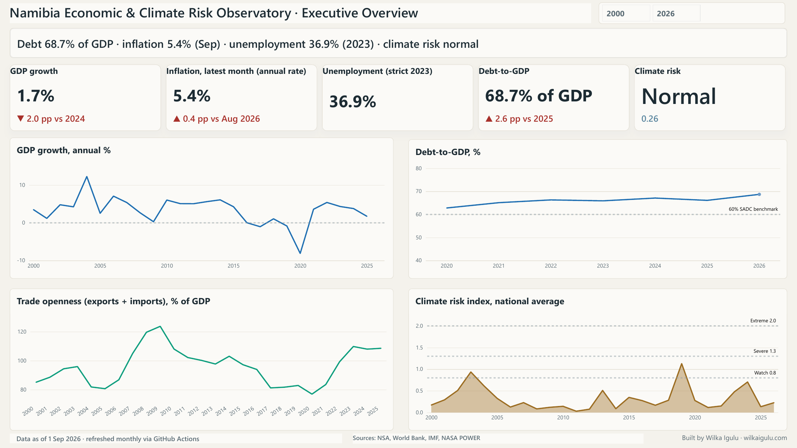
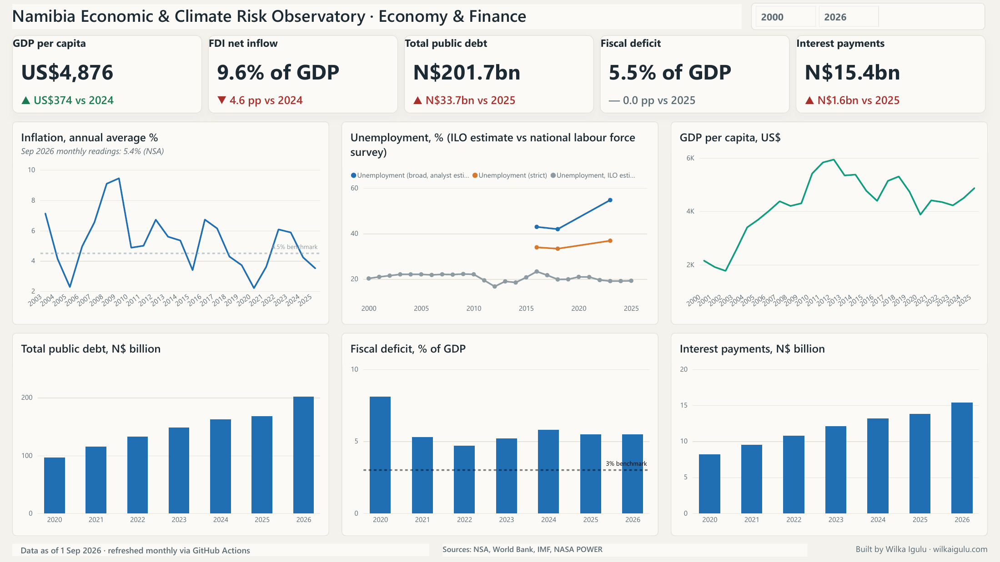
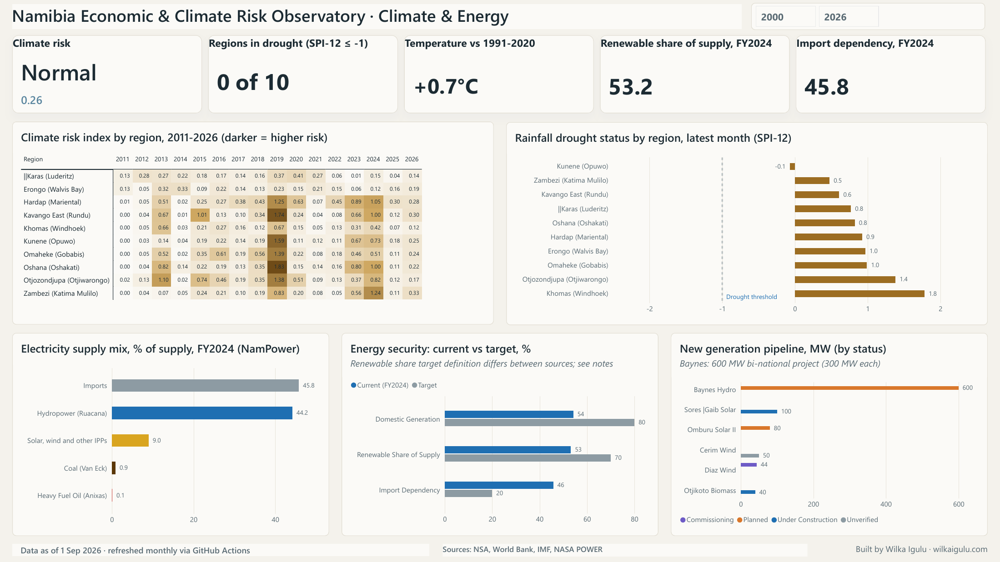
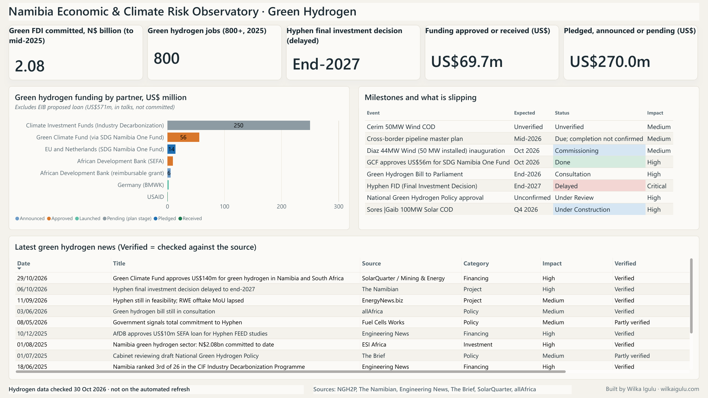

# Namibia Economic, Energy, Climate Risk & Green Hydrogen Observatory

A reproducible analytics platform monitoring Namibia's economy, public finances,
energy transition, green hydrogen sector and climate risk. A Python pipeline builds a
star-schema warehouse; a four-page Power BI report sits on top of it. National
indicators and climate data refresh monthly through GitHub Actions.

**Author:** Wilka Igulu · [wilkaigulu.com](https://wilkaigulu.com)
· Quantitative Data Analyst · Climate risk research · Economic analytics 

---

## Preview

| Executive Overview | Economy & Finance |
|---|---|
|  |  |
| **Climate & Energy** | **Green Hydrogen** |
|  |  |

## Dashboard pages

| Page | Question it answers |
|---|---|
| Executive Overview | Is Namibia's macro position improving, and is climate adding stress right now? |
| Economy & Finance | Can the state carry its debt, and what is inflation doing to households? |
| Climate & Energy | Where is drought biting, and how fast is the electricity mix changing? |
| Green Hydrogen | What money is secured, what is slipping, and what decides what happens next? |

Palette, layout grids, visual choices and DAX live in `powerbi/themes/`,
`powerbi/measures.dax` and `docs/dashboard_design.md`.

## Quick start

```bash
python -m venv .venv && source .venv/bin/activate
pip install -r requirements.txt

python pipeline.py              # full refresh (hits World Bank + NASA POWER)
python pipeline.py --offline    # rebuild the warehouse from committed CSVs only
python pipeline.py --only load validate
python src/docs_gen.py          # regenerate docs/data_dictionary.md
```

Then open `powerbi/NamibiaDashboard.pbix` and click **Home → Refresh**.

## Architecture

```
World Bank API ─┐
                ├─► data/automated/ ─┐
NASA POWER API ─┘                    │
                                     ├─► src/transform ─► src/load ─► data/warehouse/
NSA · BoN · MoF (hand-curated) ─────►│                                 fact_indicator
data/curated/                        │                                 fact_climate_monthly
                                     │                                 dim_indicator
Energy & hydrogen tables ───────────►┘                                 dim_date · dim_region
data/dimension/                                                              │
                                                src/validate (quality gate) ─┤
                                                                             ▼
                                                                    Power BI model
```

The pipeline is **fail-closed**: a step that errors aborts the run, so the warehouse
keeps its last good build instead of publishing a partial refresh. The validation gate
checks schema, nulls, duplicates, plausible ranges, staleness and that every series the
report depends on is present. A missing curated CSV therefore fails the run instead of
silently deleting a series from the dashboard.

## Warehouse

| Table | Grain | Purpose |
|---|---|---|
| `fact_indicator` | indicator × date | economic, fiscal, trade, labour and national climate series |
| `fact_climate_monthly` | region × month | SPI, temperature anomaly, composite risk per region |
| `dim_indicator` | indicator | label, unit, frequency, direction, benchmark |
| `dim_date` | month | calendar, Namibian fiscal year (Apr–Mar), rainfall season (Oct–Sep) |
| `dim_region` | region | the ten NASA POWER grid points and their zones |

Every fact row carries `unit`, `frequency` and `is_forecast`. Tables in
`data/dimension/` (electricity mix, generation pipeline, energy security and the four
green hydrogen tables) are loaded into Power BI directly and are not part of the star
schema. See [`docs/data_dictionary.md`](docs/data_dictionary.md) for the series list.

## Climate risk methodology

Drought is measured with **SPI** (Standardised Precipitation Index, McKee et al. 1993):
monthly rainfall accumulations over 1/3/6/12-month windows, gamma-fitted per calendar
month against a fixed baseline, with a point mass at zero. Heat is a standardised
temperature index against the same baseline. The composite is **one-sided**: only
rainfall deficit and heat excess count as risk. It is reported in z-units plus an
ordinal band (Normal / Watch / Severe / Extreme).

Baseline: WMO 1991–2020 where the record allows; the transform falls back to the full
record and logs a warning when it does not.

## What updates itself, and what does not

| Data | How it is updated | When |
|---|---|---|
| World Bank indicators, NASA POWER climate | GitHub Actions (`update-data.yml`) | 1st of each month, 06:00 Windhoek |
| Debt, deficit, interest (`data/curated/debt_to_gdp.csv`) | by hand | after each budget / mid-year review |
| Annual inflation, trade, unemployment (`data/curated/`) | by hand | as NSA publishes |
| Monthly inflation (`data/curated/inflation_monthly.csv`) | by hand, one row per NSA release | monthly |
| Electricity mix, pipeline, energy security (`data/dimension/`) | by hand | with each NamPower report |
| Green hydrogen tables (`data/dimension/`) | by hand, each row sourced | as events happen |

After a scheduled refresh, run `git pull` before editing locally, then refresh Power BI.
CI (`ci.yml`) lints the code and rebuilds the warehouse offline on every push.

## Data sources

**Automated:** World Bank Indicators API · NASA POWER (daily T2M, T2M_MAX, PRECTOTCORR)

**Curated:** Namibia Statistics Agency (NCPI bulletins, labour force survey, trade) ·
Bank of Namibia · Ministry of Finance (Mid-Year Budget Review, October 2026) ·
NamPower Integrated Annual Report FY2024 · Namibia Green Hydrogen Programme and press
reports (each hydrogen row carries a `Source` and a `Verified` flag).

## Known data caveats

- **Annual vs monthly inflation.** `INFLATION` is an annual average; `INFLATION_MONTHLY`
  is the latest annual rate by month (Dec 2025 onward). January and May 2026 rest on
  one secondary source and are flagged in the file.
- **Unemployment.** The official 2023 strict rate is 36.9%. NSA says it is not
  comparable with 2018 (33.4%) because the definition changed, so the report shows no
  year-on-year change for it. The "broad" series is an analyst estimate on the old
  definition and is labelled that way.
- **Debt projections removed.** The older IMF projections for 2027–29 sat below the
  October 2026 outturn, so they were dropped rather than shown as a forecast.
- **Electricity.** `Percentage` is share of energy supplied and `Installed_Capacity_MW`
  is nameplate capacity. They are different measures and must not share an axis. The
  70% renewable target is defined differently across sources; the page says so.
- **Green hydrogen.** Checked by hand on 30 October 2026 and not on the automated
  refresh. Items that could not be fully confirmed are marked "Partly verified" or
  "Unverified" (for example Cerim wind status). The EIB's proposed loan is excluded from
  funding totals because it is not committed.
- **Trade.** Annual figures for 2020–2023 are round numbers and indicative.
- **Survey series.** The labour-force survey has three observations (2016, 2018, 2023):
  plot as points, not a trend.

## Roadmap

See [`docs/roadmap.md`](docs/roadmap.md).

## Licence

See [`LICENSE`](LICENSE).
